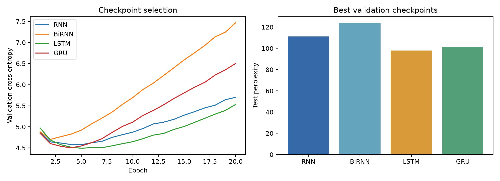
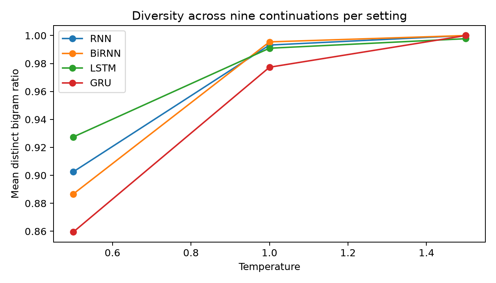

# Autoregressive text generation with recurrent networks

Foundations of Generative AI (ICT4403), Assignment 2

## Objective

Train Simple RNN, Bidirectional RNN, LSTM and GRU models to predict the next word in a fixed context, then generate text one word at a time. Compare held-out cross entropy, perplexity, next-word accuracy, training time and generated-text quality under a shared experimental protocol.

## Dataset and preprocessing

The dataset is Lewis Carroll's *Alice's Adventures in Wonderland*, an English fantasy novel containing narrative, dialogue and recurring characters. Source: [Project Gutenberg ebook 11](https://www.gutenberg.org/ebooks/11), [plain text](https://www.gutenberg.org/cache/epub/11/pg11.txt). The downloaded original and its licence are included in `data/alice.txt`; provenance is in `data/SOURCE.md`.

The program strips the Gutenberg header/footer and front matter, lowercases, normalizes curly apostrophes and extracts word tokens. Internal apostrophes are retained; numbers and punctuation are discarded. Consequently, generated output is lowercase and has no punctuation. This simplifies word prediction but limits readability and sentence-boundary learning.

The token stream is divided chronologically into 80% training, 10% validation and 10% test **before** constructing windows. Adjacent windows within a split overlap, but no window crosses a split boundary. The vocabulary is fitted only on training words with frequency at least two. Other words map to `<unk>`. Exact counts and out-of-vocabulary rates are in `results/dataset.json`.

Each example contains 12 consecutive input words and the immediately following target word. For example, `alice was beginning to get very tired of sitting by her sister` predicts `on`. With N tokens in a split, there are N - 12 examples. There is no padding in training; short generation seeds use their available context.

## Models and fair comparison

All models use a learned 64-dimensional embedding, one recurrent layer with 96 hidden units per direction, and a linear vocabulary classifier. RNN and BiRNN use tanh recurrence. LSTM uses input, forget and output gates with a cell state; GRU uses reset and update gates.

The BiRNN concatenates the final forward and backward hidden states over the **observed context only**. It never receives the next-word target. It is therefore usable for this window-based autoregressive generator, although each rolling context is recomputed and its bidirectionality must not be confused with access to future generated words.

Every model receives the same splits, batches, vocabulary, context, initialization seed, epoch budget and optimizer settings: Adam at 0.003, batch size 128, 20 epochs, cross entropy and gradient norm clipping at 1.0. The checkpoint with lowest validation loss is selected separately for each model. Test data is used only after checkpoint selection. Parameter counts differ naturally by architecture; this is a matched training-protocol comparison, not a matched parameter-budget experiment. Training time includes forward/backward passes and optimizer updates across all 20 epochs, excluding validation, checkpoint I/O and sampling.

## Run the project

Python 3.12 is recommended. Run these commands from this directory:

```bash
python -m venv .venv
# Windows PowerShell
.venv\Scripts\Activate.ps1
# macOS / Linux: source .venv/bin/activate
python -m pip install -r requirements.txt
python -m unittest -v test_project.py
python train.py
python generate.py --model LSTM --seed "the white rabbit" --temperature 0.5 --words 50
```

The saved checkpoints allow generation without retraining. CPU execution is the default and uses four threads. A complete training run overwrites results and checkpoints. A quick smoke run can use `python train.py --epochs 1`; it will replace the supplied experimental outputs, so run it in a copy if you want to preserve them. Timing and floating-point results may differ across hardware and package builds. The exact recorded environment is in `results/config.json`.

## Evaluation definitions

- Loss: mean negative log probability of the correct target, in natural-log units.
- Perplexity: exp(mean loss), computed across all test targets. Lower is better.
- Accuracy: fraction of targets equal to the highest-probability prediction.
- Distinct-1 / distinct-2: unique generated unigrams / bigrams divided by total generated unigrams / bigrams. Higher means greater lexical diversity, not necessarily greater coherence.
- Repetition: 1 - distinct-2, the fraction of bigram occurrences beyond their first occurrence. Seed words are excluded from these diversity measures.

Perplexity includes `<unk>` targets and all vocabulary logits. A smoothed training-frequency unigram baseline provides a reference. The generation distribution suppresses `<unk>` and uses softmax(logits / temperature); the evaluation distribution does not suppress any class. The two distributions therefore serve different purposes.

## Temperature experiment

All four models use the same three seeds (`alice was beginning to get very tired`, `the white rabbit`, `she looked at the`) at temperatures 0.5, 1.0 and 1.5. Each combination has three reproducible random draws of 50 new words, giving 108 continuations. Identical random seeds are reused across models and temperatures. Complete text and diversity measurements are in `results/samples.csv`; means over nine continuations per model-temperature setting are in `results/temperature_summary.csv`.

## Results and interpretation

The completed 20-epoch CPU run produced the following results from each model's best validation checkpoint:

| Model | Test loss | Test perplexity | Test accuracy | Training seconds |
|---|---:|---:|---:|---:|
| Simple RNN | 4.7110 | 111.16 | 17.39% | 25.28 |
| Bidirectional RNN | 4.8193 | 123.87 | 14.72% | 39.50 |
| LSTM | 4.5836 | 97.86 | 17.95% | 35.99 |
| GRU | 4.6191 | 101.40 | 18.18% | 44.27 |

**LSTM is the recommended model for this run:** it has the lowest validation loss and test perplexity, and the lowest repeated-bigram fraction at temperature 0.5. GRU has a small advantage in next-word accuracy. All four outperform the unigram baseline (perplexity 204.81; accuracy 8.47%). LSTM's 0.5 samples contain readable local phrases, but no model consistently maintains a coherent story.

Temperature 0.5 gives the most readable short phrases among the inspected settings. Raising it to 1.0 and 1.5 increases distinct-word and distinct-bigram ratios and reduces repetition, while the displayed examples lose grammatical and contextual consistency. For LSTM, distinct-2 rises from 0.927 at 0.5 to 0.991 at 1.0 and 0.998 at 1.5. Greater diversity alone is therefore not evidence of better generation.

See [REPORT.md](REPORT.md) for measured results, representative generated text, qualitative comparison, temperature analysis and the final model recommendation.





## Repository contents

```text
train.py                     preprocessing, training, evaluation, sampling, plots
generate.py                  inference from a saved checkpoint
test_project.py              alignment, gradient and reproducibility checks
requirements.txt             dependencies
REPORT.md                    measured findings and interpretation
data/alice.txt               original source with Gutenberg licence
data/SOURCE.md               dataset provenance
checkpoints/*.pt             best validation checkpoint per model
results/comparison.csv      test metrics and training times
results/history.csv         epoch-level loss and timing
results/samples.csv         all 108 generated continuations
results/temperature_summary.csv
results/baseline.json       unigram baseline
results/dataset.json        dataset statistics
results/config.json         run configuration and environment
results/vocab.json           training vocabulary
results/*.png               comparison charts
```

## Limitations

This is a small-corpus, single-training-seed experiment with a short context and no pretraining. Chronological splits test later passages, which can introduce different vocabulary and topics. Repeated generation draws measure sampling variation, not training uncertainty. Quantitative diversity is not a measure of semantic correctness. Generated passages should be inspected alongside the metrics; no model is expected to produce consistently coherent long stories with this data budget. A stronger follow-up would repeat training seeds, match parameter budgets, preserve punctuation, enlarge the corpus and assess generations with blinded human ratings.
